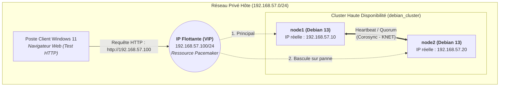

# Documentation : Haute Disponibilité Web (Corosync & Pacemaker)

**Auteur :** Loris.R  
**Module :** BTS SIO 2 - SISR  
**Sujet :** Mise en œuvre d'un cluster de haute disponibilité Actif/Passif pour un service Web Apache2 sous Debian 13 avec Corosync et Pacemaker

---

!!! abstract "Notes"
    Ce guide présente l'installation, la configuration et la validation d'une infrastructure de **Haute Disponibilité (HA)** reposant sur deux nœuds sous **Debian 13 (Trixie)**. L'objectif est de rendre un service Web (**Apache2**) résilient aux pannes grâce à l'utilisation conjointe de **Corosync** (gestion de la communication inter-nœuds et du quorum) et de **Pacemaker** (ordonnancement et gestion des ressources du cluster, dont l'adresse IP virtuelle flottante).

---

## Topologie réseau et architecture

Pour l'ensemble des manipulations présentées dans cette documentation, l'infrastructure s'articule autour d'un réseau privé hôte (`192.168.57.0/24`) regroupant deux serveurs Web en cluster ainsi qu'un poste client pour les tests de continuité de service :

- **Sous-réseau du cluster (`192.168.57.0/24`) :**
    * **`node1` (`192.168.57.10/24`) :** Premier nœud du cluster sous Debian 13 (interface `ens18`, MAC `bc:24:11:a1:5b:47`). Héberge les ressources par défaut.
    * **`node2` (`192.168.57.20/24`) :** Second nœud du cluster sous Debian 13 (clone de `node1` avec adresse MAC régénérée). Prend le relais en cas de défaillance de `node1`.
    * **IP Flottante / VIP (`192.168.57.100/24`) :** Adresse IP virtuelle partagée gérée dynamiquement par Pacemaker. C'est l'unique point d'entrée interrogé par les clients HTTP.
    * **Passerelle (`192.168.57.254`) :** Passerelle par défaut du segment réseau.



---

## 1. Lexique et concepts fondamentaux de la Haute Disponibilité

Afin d'appréhender le fonctionnement interne de notre architecture, voici la définition des concepts et composants clés mis en œuvre dans ce TP :

- **Haute Disponibilité (HA - *High Availability*) :** Architecture visant à garantir la continuité opérationnelle d'un service informatique 24/7 en éliminant les points de défaillance uniques (**SPOF** - *Single Point of Failure*).
- **Cluster (Grappe de serveurs) :** Regroupement de plusieurs serveurs indépendants (appelés **nœuds** ou *nodes*) interconnectés pour fonctionner comme un système unique aux yeux des clients.
- **IP Flottante (VIP - *Virtual IP*) :** Adresse IP logique qui n'est pas attachée en dur dans la configuration système d'un serveur physique, mais attribuée dynamiquement par le gestionnaire de cluster au nœud actif. En cas de panne, cette IP « flotte » (bascule) instantanément sur la carte réseau du serveur de secours.
- **Corosync :** Moteur de messagerie et d'appartenance du cluster (*Cluster Messaging Layer*). Il établit des battements de cœur (*heartbeats*) constants entre les nœuds via le protocole **KNET** (*Kronosnet*) pour détecter en temps réel quels serveurs sont présents ou hors ligne, et calcule le **quorum**.
- **Pacemaker :** Gestionnaire de ressources du cluster (**CRM** - *Cluster Resource Manager*). En fonction de l'état de santé des nœuds communiqué par Corosync, c'est lui qui orchestre le démarrage, l'arrêt, la surveillance (*monitoring*) et la migration des services (IP virtuelle, Apache2).
- **Quorum :** Mécanisme démocratique de vote garantissant l'intégrité du cluster. Pour qu'une partition du cluster soit autorisée à héberger des services, elle doit réunir la majorité stricte des voix (de ce que jai compris)
    * *Cas particulier du cluster à 2 nœuds :* La perte d'un nœud laisse le survivant avec exactement 50% des voix (majorité stricte non atteinte). On active alors l'option `two_node: 1` (dans Corosync) et `no-quorum-policy=ignore` (dans Pacemaker) pour autoriser le nœud restant à maintenir la production.
- **Split-Brain (*Cerveau scindé*) :** Scénario critique dans lequel le lien réseau privé reliant les nœuds est rompu, alors que les deux serveurs sont toujours allumés. Ne recevant plus les battements de cœur de son pair, chaque nœud croit que l'autre est mort et s'approprie simultanément l'IP flottante et les services. Cela provoque des conflits d'adresse IP (ARP) et de graves corruptions de données.
- **STONITH (*Shoot The Other Node In The Head*) / Fencing :** Mécanisme d'isolation radicale conçu pour prévenir le *Split-Brain*. Lorsqu'un nœud ne répond plus, le nœud survivant utilise un canal matériel externe pour arrêter le serveur douteux avant de monter les ressources.
- **Colocation et Ordre (Groupe de ressources) :** Contraintes logiques définies dans Pacemaker. La **colocation** oblige deux ressources (la VIP et le serveur Web Apache2) à s'exécuter sur la même machine physique, tandis que l'**ordre** garantit que l'adresse IP virtuelle est montée sur l'interface réseau avant le lancement du démon Apache2.

---

## 2. Préparation du nœud maître (`node1`) avant clonage

!!! tip "Stratégie de déploiement par clonage"
    Afin d'éviter tout problèmes, l'ensemble des paquets, la résolution de noms et les configurations de base est d'abord préparé sur **`node1`**. puis la machine virtuelle sera/est clonée pour générer **`node2`**, ce qui garantit une homogénéité logicielle parfaite entre les deux machines du cluster.

### A. Vérification de l'identité et de la configuration IP de `node1`

Le premier serveur est nommé `node1` et dispose d'une configuration réseau statique sur son interface principale `ens18`.

```bash
# Définition permanente du nom d'hôte (si nécessaire)
hostnamectl set-hostname node1

# Configuration IP et DNS
nano /etc/network/interfaces
nano /etc/resolv.conf
```

*Explication des commandes :*
- `hostnamectl set-hostname node1` : modifie le fichier `/etc/hostname` et applique immédiatement le nom système `node1` au noyau.


On relève ici les informations essentielles de **`node1`** :
- **Interface réseau :** `ens18`
- **Adresse IPv4 :** `192.168.57.10/24`
- **Adresse MAC :** `bc:24:11:a1:5b:47`

---

### B. Configuration de la résolution de noms locale (`/etc/hosts`)

Pour communiquer efficacement, Corosync et Pacemaker ne doivent jamais dépendre d'un serveur DNS externe susceptible de tomber en panne. La résolution mutuelle des noms `node1` et `node2` vers leurs adresses IP réelles est donc inscrite en dur dans `/etc/hosts` :

```bash
nano /etc/hosts
```

Contenu ajouté dans le fichier :

```text
127.0.0.1       localhost
127.0.1.1       debian13simple
192.168.57.10   node1
192.168.57.20   node2
```


!!! info "Synchronisation horaire (NTP)"
    Sous Debian 13, le service `systemd-timesyncd` assure nativement la synchronisation de l'horloge système. Il est primordial que les deux nœuds soient parfaitement à la même heure (vérifiable via `timedatectl status`)

---

### C. Installation d'Apache2 et de la pile de clustering

On procède à la mise à jour de l'index des dépôts puis à l'installation du serveur Web et des composants de haute disponibilité :

```bash
apt update && apt install -y apache2 pacemaker corosync pcs crmsh
```

*Explication détaillée de la commande :*
- `apt update` : rafraîchit la liste des paquets disponibles depuis les miroirs Debian 13.
- `&&` : opérateur logique qui n'exécute la seconde commande que si la première s'est terminée sans erreur.
- `apt install -y` : installe les paquets demandés en répondant automatiquement « oui » (`-y`) aux confirmations.
- `apache2` : le serveur HTTP que l'on souhaite rendre hautement disponible.
- `corosync` : la couche de communication inter-nœuds et de gestion du quorum.
- `pacemaker` : le gestionnaire de ressources du cluster.
- `pcs` et `crmsh` (*Cluster Resource Manager Shell*) : interfaces en ligne de commande permettant d'administrer facilement Pacemaker. nous n'utiliserons que **`crmsh`** (commande `crm`).


---

### D. Désactivation du démarrage automatique d'Apache2 au boot

!!! warning "Gouvernance exclusive par Pacemaker"
    Il est impératif que `systemd` ne démarre **pas** le service `apache2` automatiquement au lancement de Debian. Si Apache démarrait tout seul au boot des deux serveurs en dehors du contrôle de Pacemaker, cela fausserait l'état du cluster. C'est **Pacemaker** qui doit détenir la gouvernance complète du démon.

```bash
# Arrêt immédiat du démon Apache2
systemctl stop apache2

# Désactivation du lancement automatique au démarrage du système
systemctl disable apache2

# Vérification de l'état du service
systemctl status apache2
```

*Explication des commandes :*
- `systemctl stop apache2` : interrompt immédiatement le processus Apache2 en cours d'exécution.
- `systemctl disable apache2` : supprime les liens symboliques du service dans `/etc/systemd/system/multi-user.target.wants/`, empêchant son exécution lors des prochains redémarrages.
- `systemctl status apache2` : permet de confirmer que le service apparaît bien comme `Loaded: loaded (...; disabled)` et `Active: inactive (dead)`.


---

## 3. Clonage, configuration de `node2` et personnalisation Web

Une fois `node1` éteint proprement, un clone intégral de la machine virtuelle est réalisé depuis proxmox en veillant à ce que  **l'adresse MAC soit bien régenerer** afin d'éviter tout conflit.

### A. Renommage et adressage IP du second nœud (`node2`)

Au premier démarrage du clone, celui-ci porte encore le nom et l'adresse IP de `node1`. On modifie immédiatement son nom d'hôte :

```bash
hostnamectl set-hostname node2
```


On édite ensuite le fichier de configuration réseau `/etc/network/interfaces` pour lui attribuer l'adresse statique `192.168.57.20` :

```bash
nano /etc/network/interfaces
```

Configuration appliquée sur **`node2`** :

```text
source /etc/network/interfaces.d/*

# The loopback network interface
auto lo
iface lo inet loopback

# The primary network interface
allow-hotplug ens18
iface ens18 inet static
        address 192.168.57.20
        netmask 255.255.255.0
        gateway 192.168.57.254
```


Après un redémarrage du service réseau (`systemctl restart networking`) ou de la machine, `node1` (`192.168.57.10`) et `node2` (`192.168.57.20`) disposent chacun d'un couple IP / Adresse MAC unique et peuvent se joindre mutuellement par leurs noms d'hôtes grâce au fichier `/etc/hosts` hérité du clonage.

---

### B. Personnalisation de l'en-tête des deux sites Web

Afin d'identifier immédiatement quel nœud du cluster répond aux requêtes HTTP envoyées sur l'IP flottante (`192.168.57.100`), nous modifions la page d'accueil `/var/www/html/index.html` sur chacun des deux serveurs.

* **Sur `node1` :**

```bash
echo "<h1>Serveur Web : NODE 1</h1>" > /var/www/html/index.html
```


* **Sur `node2` :**

```bash
echo "<h1>Serveur Web : NODE 2</h1>" > /var/www/html/index.html
```


*Explication de la commande :* `echo "..." > /var/www/html/index.html` écrase (`>`) la page par défaut d'Apache2 par un titre HTML de niveau 1 (`<h1>`) indiquant clairement l'identité du serveur actif.

---

## 4. Mise en place de la couche de messagerie Corosync

### A. Configuration du fichier `/etc/corosync/corosync.conf`

Sur **`node1`**, on édite le fichier principal `/etc/corosync/corosync.conf` pour déclarer explicitement les deux membres du cluster et activer le mode spécifique à deux nœuds (`two_node: 1`) :

```bash
nano /etc/corosync/corosync.conf
```

Structure du fichier configuré :

```text
totem {
    version: 2
    cluster_name: debian_cluster
    transport: knet
    crypto_cipher: none
    crypto_hash: none
}

nodelist {
    node {
        ring0_addr: 192.168.57.10
        name: node1
        nodeid: 1
    }
    node {
        ring0_addr: 192.168.57.20
        name: node2
        nodeid: 2
    }
}

quorum {
    provider: corosync_votequorum
    two_node: 1
}

logging {
    to_logfile: yes
    logfile: /var/log/corosync/corosync.log
    to_syslog: yes
    timestamp: on
}
```

*Explication des directives :*
- **Section `totem` :** configure le protocole d'échange des battements de cœur (*Heartbeat*) via le transport moderne `knet` et baptise le cluster `debian_cluster`.
- **Section `nodelist` :** recense chaque nœud du cluster avec son adresse IP d'écoute (`ring0_addr`), son nom d'hôte (`name`) et son identifiant unique (`nodeid`).
- **Section `quorum` (`two_node: 1`) :** indique au moteur de vote `corosync_votequorum` que le cluster ne possède que deux serveurs, autorisant ainsi le maintien du quorum même lorsqu'un seul nœud est actif.

---

### B. Synchronisation de la configuration vers `node2` via SCP

Le fichier `/etc/corosync/corosync.conf` doit être strictement identique sur tous les membres du cluster. On le transfère depuis `node1` vers `node2` à l'aide du protocole SSH/SCP :

```bash
scp /etc/corosync/corosync.conf root@node2:/etc/corosync/corosync.conf
```

*Explication de la commande :* `scp` (*Secure Copy*) copie de manière chiffrée via SSH le fichier local `/etc/corosync/corosync.conf` de `node1` directement à son emplacement cible sur `node2`.


!!! note "Droits d'écriture lors du transfert SCP"
    L'écriture directe dans `/etc/corosync/` nécessitant les privilèges super-utilisateur, une tentative avec un compte standard (`sio@node2`) renvoie logiquement `Permission denied`. L'authentification avec `root@node2` permet de transférer le fichier avec succès.


---

### C. Démarrage des services et validation du Quorum

On active et on redémarre les démons `corosync` et `pacemaker` sur **`node1`** puis sur **`node2`** :

```bash
# À exécuter sur node1 ET sur node2
systemctl enable corosync pacemaker
systemctl restart corosync pacemaker
```

En contrôlant le statut des services sur **`node1`** (`systemctl status corosync pacemaker`) juste avant le redémarrage de `node2`, on observe que `node1` a démarré son moteur KNET et attend que son pair rejoigne l'anneau (`Waiting for all cluster members. Current votes: 1 expected_votes: 2`) :


On active et on relance aussitôt les services sur **`node2`** :


On vérifie maintenant l'état global du cluster à l'aide de l'outil `crm` :

```bash
crm status
```

*Explication de la commande :* `crm status` interroge Pacemaker pour afficher la synthèse du cluster : l'état du quorum (`partition with quorum`), le nœud coordinateur désigné (`Current DC: node1`), la liste des nœuds connectés (`Online: [ node1 node2 ]`) et les ressources actives.


Les deux serveurs **`node1`** et **`node2`** sont désormais en ligne (`Online`) et le quorum est établi.

---

## 5. Configuration des ressources dans Pacemaker (`crm`)

!!! info "Réplication automatique de la CIB (*Cluster Information Base*)"
    Toutes les commandes `crm configure` qui suivent sont exécutées sur un seul nœud (**`node1`**). Pacemaker stocke sa configuration au format XML dans la **CIB** et la synchronise instantanément sur tous les autres nœuds du cluster via Corosync.

### A. Propriétés globales du cluster (STONITH et Quorum)

Lors d'une première tentative de saisie, une légère faute de frappe sur le nom des attributs (`stonith-enable` sans le `d` final et `no-quprum-policy`) a provoqué un avertissement de validation du schéma de la CIB (`unknown attribute`) :


Nous avons immédiatement corrigé les propriétés avec la syntaxe exacte attendue par Pacemaker, tout en déclarant nos deux ressources (`VIP` et `WebSite`) ainsi que leur groupe (`GroupeWeb`) :

```bash
# 1. Désactivation du mécanisme STONITH
crm configure property stonith-enabled=false

# 2. Maintien du fonctionnement du cluster même en cas de perte du quorum (1 nœud sur 2)
crm configure property no-quorum-policy=ignore
```

---

### B. Création de l'IP Flottante (`VIP`), du service Apache (`WebSite`) et du groupe (`GroupeWeb`)

On déclare ensuite les deux ressources primitives et on les assemble dans un groupe logique :

```bash
# 3. Création de la ressource d'adresse IP virtuelle (VIP : 192.168.57.100/24 sur ens18)
crm configure primitive VIP ocf:heartbeat:IPaddr2 \
    params ip="192.168.57.100" cidr_netmask="24" nic="ens18" \
    op monitor interval="10s"

# 4. Création de la ressource du serveur Web Apache2
crm configure primitive WebSite ocf:heartbeat:apache \
    params configfile="/etc/apache2/apache2.conf" \
    op monitor interval="30s"

# 5. Regroupement des deux ressources pour imposer la colocation et l'ordre de démarrage
crm configure group GroupeWeb VIP WebSite
```

*Explication détaillée des commandes :*
- `crm configure primitive VIP ocf:heartbeat:IPaddr2 ...` :
    * `primitive VIP` : crée une ressource élémentaire baptisée `VIP`.
    * `ocf:heartbeat:IPaddr2` : appelle le script d'agent standard **OCF** (*Open Cluster Framework*) chargé d'ajouter ou de supprimer dynamiquement une adresse IP secondaire sur une carte réseau Linux.
    * `params ip="192.168.57.100" cidr_netmask="24" nic="ens18"` : fixe l'IP flottante à `.100/24` sur l'interface `ens18`.
    * `op monitor interval="10s"` : ordonne à Pacemaker de vérifier toutes les 10 secondes que l'adresse IP est bien présente.
- `crm configure primitive WebSite ocf:heartbeat:apache ...` :
    * Utilise l'agent OCF `apache` pointant vers `/etc/apache2/apache2.conf` avec une vérification d'état toutes les 30 secondes.
- `crm configure group GroupeWeb VIP WebSite` :
    * Réunit `VIP` et `WebSite` au sein d'un groupe nommé `GroupeWeb`. Cela garantit que **les deux ressources tournent toujours sur le même serveur** et que **`VIP` est montée avant le démarrage de `WebSite`** .


---

### C. Vérification du démarrage des ressources

On contrôle l'état du cluster avec `crm status` :

```bash
crm status
```


Le `Resource Group: GroupeWeb` est opérationnel : les ressources **`VIP`** et **`WebSite`** affichent toutes deux l'état **`Started node1`**.

---

## 6. Phase de tests : Simulation de panne et retour sur `node1`

### A. Simulation d'une panne sur `node1`

Conformément aux consignes d'évaluation, nous n'éteignons aucune machine virtuelle mais nous simulons une défaillance du gestionnaire de cluster en arrêtant uniquement le service `pacemaker` sur **`node1`** :

```bash
systemctl stop pacemaker
```

*Explication de la commande :* L'arrêt de `pacemaker` sur `node1` force ce dernier à libérer proprement les ressources qu'il hébergeait (`WebSite` puis `VIP`) avant de quitter le contrôle du cluster. Le nœud `node2` constate immédiatement que `node1` n'assure plus le service et démarre automatiquement `GroupeWeb` sur sa propre interface `ens18`.


---

### B. Vérification de la bascule automatique sur `node2`

Un simple `ip a` sur `node2` permet alors de constater que l'adresse `192.168.57.100/24` a bien migré sur la carte `ens18` de `node2` (tandis qu'elle a disparu de `node1`).

En interrogeant l'adresse de l'IP flottante **`http://192.168.57.100/`** depuis le navigateur du poste client Windows 11, le site Web répond sans aucune interruption et affiche désormais la page hébergée par **`node2`** :


La continuité de service est totalement assurée !

---

### C. Redémarrage et rapatriement du service sur `node1`

Le sujet demande de rechercher et d'exécuter les commandes permettant de refaire fonctionner le service sur le nœud n°1 (`node1`). Cette opération s'effectue en deux étapes :

1. **Relancer le démon Pacemaker sur `node1`** pour qu'il réintègre le cluster :
   ```bash
   systemctl start pacemaker
   ```
2. **Forcer la migration du groupe de ressources `GroupeWeb` vers `node1`** :
   ```bash
   crm resource move GroupeWeb node1
   ```

*Explication technique :*
- Lorsque `node1` revient en ligne avec `systemctl start pacemaker`, Pacemaker évite souvent de redéplacer les ressources immédiatement si elles fonctionnent bien sur `node2` .
- La commande `crm resource move GroupeWeb node1` crée une contrainte de localisation explicite qui ordonne à Pacemaker d'arrêter proprement `GroupeWeb` sur `node2` et de le redémarrer immédiatement sur **`node1`**.


En actualisant une dernière fois la page **`http://192.168.57.100/`** sur le navigateur du poste client, nous constatons que le trafic de l'IP flottante est de nouveau servi par **`node1`** :

