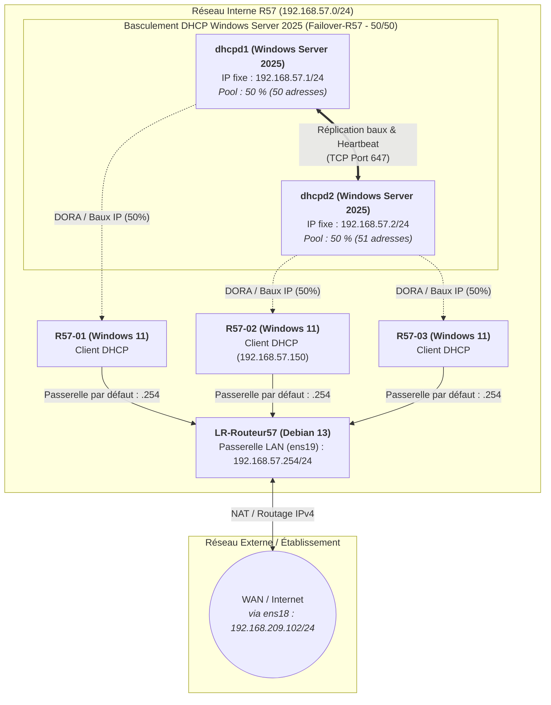

# Documentation : Haute Disponibilité DHCP (Équilibrage de charge et basculement sous Windows Server)

**Auteur :** Loris.R  
**Module :** BTS SIO 2 - SISR  
**Sujet :** Mise en œuvre d'une architecture DHCP hautement disponible en mode équilibrage de charge (50/50) et basculement sous Windows Server 2025 avec postes clients Windows 11

---

!!! abstract "Notes"
    Ce guide présente l'installation, la configuration automatisée par scripts PowerShell et la validation d'une infrastructure **DHCP Haute Disponibilité (Failover)** reposant sur deux serveurs **Windows Server 2025** en environnement virtualisé **Proxmox**. L'objectif est d'assurer la continuité de distribution des baux IPv4 sur le réseau interne `192.168.57.0/24` grâce au mode **Équilibrage de charge (Load Balance) 50/50**, permettant aux deux serveurs de répondre simultanément aux requêtes tout en garantissant une reprise automatique et transparente en cas de panne d'un des deux nœuds.

---

## Topologie réseau et architecture

Pour l'ensemble des manipulations présentées dans cette documentation, l'infrastructure s'articule autour du sous-réseau interne `192.168.57.0/24` porté par le routeur virtualisé `LR-Routeur57`, regroupant deux serveurs DHCP Windows Server 2025 et trois postes clients Windows 11 :

- **Sous-réseau interne (`192.168.57.0/24`) :**
  - **`LR-Routeur57` (`192.168.57.254/24`) :** Routeur passerelle sous Debian 13 (VM `21062` sur `pve01`). Assure le routage inter-réseaux et le NAT entre son interface LAN `ens19` (`192.168.57.254/24`, MAC `bc:24:11:f9:60:c8`) et son interface WAN `ens18` (`192.168.209.102/24`, MAC `bc:24:11:1d:1d:da`).
  - **`dhcpd1` (`192.168.57.1/24`) :** Premier serveur DHCP sous Windows Server 2025. Héberge la configuration initiale de l'étendue `Etendue-R57` (`192.168.57.100` à `192.168.57.200`) et initie la relation de basculement `Failover-R57`.
  - **`dhcpd2` (`192.168.57.2/24`) :** Second serveur DHCP sous Windows Server 2025. Installé initialement sans étendue, il reçoit automatiquement la configuration par réplication et assure 50 % de la distribution des baux en fonctionnement normal.
  - **Postes clients (`R57-01`, `R57-02`, `R57-03`) :** Trois postes sous Windows 11 configurés en adressage dynamique DHCP sur le même bridge/VLAN Proxmox.



---

## 1. Lexique et concepts fondamentaux du basculement DHCP

Afin d'appréhender le fonctionnement interne de notre architecture, voici la définition des concepts et paramètres clés mis en œuvre dans ce TP :

- **Basculement DHCP (*DHCP Failover*) :** Fonctionnalité native de Windows Server permettant à deux serveurs DHCP de partager la gestion d'une ou plusieurs étendues IPv4 afin d'assurer la haute disponibilité du service sans recourir à un cluster Windows (WSFC) complexe ni au découpage manuel en 80/20 (*Split Scope*).
- **Mode Serveur de secours (*Hot Standby*) :** Architecture Actif/Passif dans laquelle un serveur principal traite 100 % des requêtes DHCP tandis que le serveur secondaire n'intervient qu'en cas d'indisponibilité du serveur principal.
- **Mode Équilibrage de charge (*Load Balance*) :** Architecture Actif/Actif retenue pour ce TP. Les deux serveurs répondent simultanément aux requêtes clients selon un pourcentage configurable (fixé ici à **50 % / 50 %**), déterminé par un algorithme de hachage calculé sur l'adresse MAC du client.
- **Port TCP 647 :** Port réseau utilisé par le protocole de basculement DHCP pour synchroniser en temps réel la base de données des baux (*leases*) et échanger les messages d'état entre `dhcpd1` et `dhcpd2`. Le serveur initiateur (`dhcpd1`) ouvre une connexion sortante vers le serveur partenaire (`dhcpd2`) qui écoute en entrée sur ce port.
- **MCLT (*Max Client Lead Time*) :** Durée maximale supplémentaire (fixée à `01:00:00`, soit 1 heure) pendant laquelle un serveur peut prolonger un bail client de manière autonome sans avoir obtenu confirmation de son partenaire lors d'une perte de communication.
- **États d'une relation de basculement :**
  - `Normal` : Les deux serveurs communiquent nominalement et répliquent leurs baux.
  - `CommunicationInterrupted` : Un serveur a perdu le contact réseau avec son partenaire ; il continue de servir ses propres clients et attend l'expiration du délai de bascule automatique (configuré à `5 minutes`) avant de prendre l'intégralité de l'étendue (`PartnerDown`).
  - `RecoverWait` : État transitoire observé immédiatement après le redémarrage d'un serveur tombé en panne, le temps d'attendre l'expiration du *MCLT* et de resynchroniser la base de baux avec le partenaire avant de revenir à l'état `Normal`.

---

## 2. Vérification de l'infrastructure réseau et préparation des serveurs

!!! tip "Stratégie d'automatisation par scripts PowerShell"
    Les deux serveurs Windows Server 2025 étant déployés à partir d'une installation vierge en groupe de travail (*Workgroup*, sans contrôleur de domaine Active Directory), l'ensemble du paramétrage IP, de la résolution locale (`hosts`), du pare-feu et du rôle DHCP a été automatisé via des scripts PowerShell exécutés en tant qu'Administrateur.

### A. Validation de l'interface LAN sur le routeur `LR-Routeur57`

Avant de configurer les machines Windows, on contrôle sur la console Proxmox de la VM `21062 (LR-Routeur57)` que l'interface interne `ens19` porte bien l'adresse passerelle `192.168.57.254/24` et que le routage vers l'interface WAN `ens18` (`192.168.209.102/24`) est opérationnel :

```bash
ip a
```


*Légende : Console Proxmox de la VM LR-Routeur57 exécutant `ip a` — confirmation de l'état `UP` de l'interface WAN `ens18` (`192.168.209.102/24`) et de l'interface LAN `ens19` (`192.168.57.254/24`) servant de passerelle au réseau interne.*

On relève sur cette capture les paramètres réseau de référence :
- **Interface WAN (`ens18`) :** `192.168.209.102/24` (MAC `bc:24:11:1d:1d:da`)
- **Interface LAN (`ens19`) :** `192.168.57.254/24` (MAC `bc:24:11:f9:60:c8`) — passerelle par défaut du réseau interne.

---

### B. Configuration réseau, résolution locale et installation du rôle DHCP sur `dhcpd1` et `dhcpd2`

En environnement *Workgroup* (sans serveur DNS interne dédié), la console MMC DHCP et le protocole de basculement doivent pouvoir résoudre mutuellement les noms `dhcpd1` et `dhcpd2` vers leurs adresses IP statiques. Le script d'initialisation inscrit donc ces entrées dans le fichier `C:\Windows\System32\drivers\etc\hosts`, fixe l'IP statique, installe la fonctionnalité `DHCP`, ouvre les règles de pare-feu requises et renomme chaque serveur avant redémarrage.

- **Script exécuté sur `dhcpd1` (`Setup-DHCP1-Init.ps1`) :**

```powershell
$Hostname   = "dhcpd1"
$IPAddress  = "192.168.57.1"
$Prefix     = 24
$Gateway    = "192.168.57.254"
$DNS        = @("192.168.57.254", "1.1.1.1")

# 1. Configuration IP statique sur la carte reseau active
$Adapter = Get-NetAdapter | Where-Object { $_.Status -eq 'Up' } | Select-Object -First 1
Set-NetIPInterface -InterfaceIndex $Adapter.ifIndex -Dhcp Disabled
Remove-NetIPAddress -InterfaceIndex $Adapter.ifIndex -AddressFamily IPv4 -Confirm:$false -ErrorAction SilentlyContinue
Remove-NetRoute -InterfaceIndex $Adapter.ifIndex -AddressFamily IPv4 -Confirm:$false -ErrorAction SilentlyContinue
New-NetIPAddress -InterfaceIndex $Adapter.ifIndex -IPAddress $IPAddress -PrefixLength $Prefix -DefaultGateway $Gateway | Out-Null
Set-DnsClientServerAddress -InterfaceIndex $Adapter.ifIndex -ServerAddresses $DNS
Set-NetConnectionProfile -InterfaceIndex $Adapter.ifIndex -NetworkCategory Private

# 2. Resolution de noms locale (indispensable en Workgroup)
$HostsFile = "$env:SystemRoot\System32\drivers\etc\hosts"
if (-not (Select-String -Path $HostsFile -Pattern "dhcpd1" -Quiet)) {
    Add-Content -Path $HostsFile -Value "`n192.168.57.1`tdhcpd1`n192.168.57.2`tdhcpd2"
}

# 3. Installation du role DHCP et regles de pare-feu (UDP 67/68, TCP 647, ICMP)
Install-WindowsFeature -Name DHCP -IncludeManagementTools
Enable-NetFirewallRule -DisplayGroup "Serveur DHCP" -ErrorAction SilentlyContinue
Enable-NetFirewallRule -DisplayGroup "DHCP Server" -ErrorAction SilentlyContinue
New-NetFirewallRule -DisplayName "DHCP Failover TCP 647" -Direction Inbound -Protocol TCP -LocalPort 647 -Action Allow -ErrorAction SilentlyContinue | Out-Null
Enable-NetFirewallRule -Name "FPS-ICMP4-ERQ-In" -ErrorAction SilentlyContinue

# 4. Renommage et redemarrage
if ($env:COMPUTERNAME -ne $Hostname) {
    Rename-Computer -NewName $Hostname -Force
}
Restart-Computer -Force
```

*Explication détaillée des commandes :*
- `New-NetIPAddress` / `Set-DnsClientServerAddress` : configure l'adresse IPv4 fixe (`192.168.57.1/24` sur `dhcpd1` et `192.168.57.2/24` sur `dhcpd2`), la passerelle `.254` et les serveurs DNS.
- `Add-Content -Path $HostsFile` : inscrit les correspondances `dhcpd1` (`192.168.57.1`) et `dhcpd2` (`192.168.57.2`) dans le fichier `hosts` afin de garantir la résolution de noms hors domaine Active Directory.
- `Install-WindowsFeature -Name DHCP -IncludeManagementTools` : installe le service Windows `dhcpserver` ainsi que la console graphique `dhcpmgmt.msc` et le module PowerShell `DhcpServer`.
- `Enable-NetFirewallRule` / `New-NetFirewallRule` : autorise le trafic DHCP (`UDP 67/68`), les requêtes ICMP (`ping`) et le flux de réplication Failover sur le port **TCP 647**.

Le même script est exécuté sur **`dhcpd2`** en adaptant uniquement `$Hostname = "dhcpd2"` et `$IPAddress = "192.168.57.2"`.

Après redémarrage des deux serveurs, on valide l'identité (`hostname`) et la résolution mutuelle par `ping` depuis `dhcpd1` puis depuis `dhcpd2` :


*Légende : Terminal PowerShell sur `dhcpd1` — validation du nom d'hôte (`dhcpd1`) et de la résolution locale via le fichier `hosts` vers `dhcpd2` (`192.168.57.2`) avec 0 % de perte après son redémarrage.*

*(Nota : sur `dhcpd1`, la première tentative `ping dhcpd2` a échoué pendant le redémarrage de `dhcpd2`, puis a immédiatement abouti avec 0 % de perte vers `192.168.57.2` dès la fin du démarrage.)*


*Légende : Terminal PowerShell sur `dhcpd2` — vérification du renommage (`dhcpd2`) et test de connectivité ICMP réussi vers le serveur principal `dhcpd1` (`192.168.57.1`).*

---

## 3. Configuration de l'étendue et de la relation de basculement 50/50

### A. Finalisation du service DHCP sur le serveur partenaire (`dhcpd2`)

Conformément aux consignes du TP, aucune étendue ne doit être créée manuellement sur **`dhcpd2`**. On finalise uniquement les groupes de sécurité locaux (*Administrateurs DHCP* et *Utilisateurs DHCP*) et on redémarre le service :

```powershell
netsh dhcp add securitygroups
Restart-Service dhcpserver
Get-Service dhcpserver
```

*Explication des commandes :*
- `netsh dhcp add securitygroups` : crée les groupes locaux nécessaires à l'administration du service DHCP et met à jour les permissions ACL.
- `Restart-Service dhcpserver` : redémarre le démon DHCP pour prendre en compte les groupes de sécurité.


*Légende : Finalisation post-déploiement sur `dhcpd2` — création des groupes de sécurité locaux (`netsh dhcp add securitygroups`), redémarrage du service et confirmation de son état actif (`Running`).*

---

### B. Création de l'étendue et du basculement 50/50 sur le serveur principal (`dhcpd1`)

Sur **`dhcpd1`**, on exécute le script `Setup-DHCP1-Failover.ps1` pour finaliser les groupes de sécurité, créer l'étendue IPv4 `Etendue-R57`, définir les options de passerelle et de DNS, puis établir la relation de basculement `Failover-R57` en équilibrage de charge **50/50** avec `dhcpd2` :

```powershell
# 1. Finalisation post-deploiement du service DHCP
netsh dhcp add securitygroups
Restart-Service dhcpserver

# 2. Creation de l'etendue IPv4 192.168.57.100 - 192.168.57.200
Add-DhcpServerv4Scope `
    -Name "Etendue-R57" `
    -StartRange 192.168.57.100 `
    -EndRange 192.168.57.200 `
    -SubnetMask 255.255.255.0 `
    -LeaseDuration 08:00:00 `
    -State Active

# 3. Configuration des options (Passerelle .254 et DNS)
Set-DhcpServerv4OptionValue `
    -ScopeId 192.168.57.0 `
    -Router 192.168.57.254 `
    -DnsServer 192.168.57.254, 1.1.1.1

# 4. Configuration du basculement en equilibrage de charge 50/50 avec dhcpd2
Add-DhcpServerv4Failover `
    -ComputerName "dhcpd1" `
    -Name "Failover-R57" `
    -PartnerServer "dhcpd2" `
    -ScopeId 192.168.57.0 `
    -LoadBalancePercent 50 `
    -MaxClientLeadTime 01:00:00 `
    -AutoStateTransition $true `
    -StateSwitchInterval 00:05:00 `
    -SharedSecret "BtsSio2026!" `
    -Force
```

*Explication détaillée des paramètres :*
- `Add-DhcpServerv4Scope` : déclare le pool de **101 adresses IPv4** (`192.168.57.100` à `192.168.57.200`) avec une durée de bail de 8 heures (`08:00:00`).
- `Set-DhcpServerv4OptionValue` : diffuse automatiquement aux clients l'option `003 Routeur` (`192.168.57.254`) et l'option `006 Serveurs DNS` (`192.168.57.254`, `1.1.1.1`).
- `Add-DhcpServerv4Failover` :
  - `-LoadBalancePercent 50` : active le mode *LoadBalance* avec répartition à parts égales (50 % pour `dhcpd1`, 50 % pour `dhcpd2`).
  - `-AutoStateTransition $true -StateSwitchInterval 00:05:00` : autorise le serveur survivant à prendre automatiquement le contrôle total de l'étendue si son partenaire reste injoignable plus de 5 minutes.
  - `-SharedSecret` : chiffre et authentifie les échanges de réplication sur le port TCP 647.

Dans la console graphique `dhcpmgmt.msc` de **`dhcpd1`**, l'étendue `[192.168.57.0] Etendue-R57` apparaît immédiatement active et associée à la relation **`Failover-R57`** :


*Légende : Console graphique DHCP sur `dhcpd1` — affichage de l'étendue `[192.168.57.0] Etendue-R57` en état `** Actif **` et associée à la relation de basculement `Failover-R57`.*

---

### C. Vérification technique de la réplication et des flux TCP 647

On contrôle l'état de la relation de basculement, la liaison d'interface et la connectivité TCP 647 sur chacun des deux serveurs via PowerShell :

```powershell
Get-DhcpServerv4Failover | Format-List Name, PartnerServer, Mode, LoadBalancePercent, State
Get-DhcpServerv4Binding | Format-Table InterfaceAlias, IPAddress, BindingState
Test-NetConnection -ComputerName "dhcpd2" -Port 647
```

- **Sur `dhcpd1` :** la relation `Failover-R57` affiche `Mode : LoadBalance`, `LoadBalancePercent : 50` et `State : Normal`, avec l'interface `Ethernet` (`192.168.57.1`) liée (`BindingState : True`). *(Le test local sur `dhcpd1:647` renvoie logiquement `False` car seul le partenaire `dhcpd2` écoute en entrée sur le port TCP 647.)*


*Légende : Contrôle PowerShell sur `dhcpd1` — relation `Failover-R57` en état `Normal` (`LoadBalance` à `50` %), liaison active (`BindingState : True`) sur `192.168.57.1` et absence logique d'écoute entrante TCP 647 côté initiateur.*

- **Sur `dhcpd2` :** l'étendue `192.168.57.0` s'est automatiquement répliquée avec l'état `Active`, la relation `Failover-R57` est en état `Normal` et le port d'écoute `TCP 647` sur `192.168.57.2` répond positivement (`TcpTestSucceeded : True`) :


*Légende : Contrôle PowerShell sur `dhcpd2` — confirmation de la réplication automatique de l'étendue `Etendue-R57` (`State : Active`) et de la synchronisation en état `Normal` avec `dhcpd1`.*

!!! note "Comportement de la console MMC (`dhcpmgmt.msc`) sur le serveur partenaire en Workgroup"
    Sur `dhcpd2`, bien que l'étendue `[192.168.57.0]` et la relation `Failover-R57` apparaissent dans la console graphique `dhcpmgmt.msc`, l'option contextuelle *« Afficher les statistiques... »* reste grisée. En environnement **Workgroup** (sans domaine Active Directory), les restrictions de sécurité DCOM/RPC entre serveurs limitent l'affichage de certains compteurs graphiques distants. L'interrogation directe en PowerShell via `Get-DhcpServerv4ScopeStatistics -ScopeId 192.168.57.0 -Failover` contourne cette limitation graphique et expose l'intégralité des compteurs répliqués.


*Légende : Console graphique DHCP sur `dhcpd2` — présence de l'étendue répliquée et de la relation `Failover-R57`, mais menu « Afficher les statistiques... » grisé en raison des restrictions DCOM/RPC hors domaine Active Directory.*

---

## 4. Configuration des postes clients Windows 11

Sur chacun des trois postes clients (`R57-01`, `R57-02`, `R57-03`), raccordés au même bridge/VLAN Proxmox que `dhcpd1`, `dhcpd2` et `LR-Routeur57`, on configure la carte réseau en client DHCP dynamique et on renouvelle le bail :

```powershell
$ClientName = "R57-02" # Adapter selon le poste : R57-01, R57-02 ou R57-03

$Adapter = Get-NetAdapter | Where-Object { $_.Status -eq 'Up' } | Select-Object -First 1
Set-NetIPInterface -InterfaceIndex $Adapter.ifIndex -Dhcp Enabled
Set-DnsClientServerAddress -InterfaceIndex $Adapter.ifIndex -ResetServerAddresses
Set-NetConnectionProfile -InterfaceIndex $Adapter.ifIndex -NetworkCategory Private

ipconfig /release
ipconfig /renew

if ($env:COMPUTERNAME -ne $ClientName) {
    Rename-Computer -NewName $ClientName -Force
}
```

---

## 5. Protocole de validation : Batterie de tests et preuves

Conformément aux exigences du sujet, quatre scénarios de validation (**T1** à **T4**) ont été exécutés afin de vérifier l'attribution initiale, la répartition 50/50, la tolérance aux pannes et la resynchronisation après reprise.

### Synthèse du cahier de tests

| ID | Scénario testé | Action menée | Résultat attendu | Résultat obtenu |
| :--- | :--- | :--- | :--- | :--- |
| **T1** | **Obtention d'adresse IP par les clients** | Passage des postes clients Windows 11 en DHCP et exécution de `ipconfig /renew`. | Attribution d'une adresse dans `192.168.57.100–200`, masque `/24`, passerelle `.254`. | **Validé** (`R57-02` obtient `192.168.57.151` puis `192.168.57.150` ; 3 baux actifs enregistrés). |
| **T2** | **Répartition 50/50 et réplication des baux** | Consultation des statistiques d'étendue et des compteurs Failover sur `dhcpd1` et `dhcpd2`. | Partage équitable des 101 adresses (~50/51) et visibilité des baux sur les deux serveurs. | **Validé :** 50 adresses disponibles sur `dhcpd1` et 51 sur `dhcpd2` (48 libres + 3 attribuées). |
| **T3** | **Indisponibilité de `dhcpd1`** | Arrêt du service DHCP sur `dhcpd1` (`Stop-Service dhcpserver`), contrôle de l'état de `dhcpd2` et renouvellement client sur `R57-02`. | `dhcpd2` détecte la coupure (`CommunicationInterrupted`) et délivre seul les baux clients (`192.168.57.2`). | **Validé :** `dhcpd1` `Stopped`, `dhcpd2` en `CommunicationInterrupted` et `R57-02` obtient `192.168.57.150` via `192.168.57.2`. |
| **T4** | **Remise en service de `dhcpd1`** | Redémarrage du service sur `dhcpd1` (`Start-Service dhcpserver`) et vérification de la resynchronisation. | Passage par l'état `RecoverWait`, resynchronisation des baux et retour à l'état `Normal`. | **Validé :** `dhcpd1` passe par `RecoverWait`, synchronise les baux et revient en état `Normal`. |

---

### Détail des preuves et analyses des tests

#### A. Tests T1 et T2 — Attribution des adresses et partage 50/50

Sur **`dhcpd1`**, la fenêtre graphique **Statistiques sur l'étendue 192.168.57.0** confirme que les **101 adresses** de la plage sont équitablement réparties entre les deux partenaires (**50 adresses** disponibles sur `dhcpd1` et **51 adresses** gérées par `dhcpd2`, dont 49 libres et 2 déjà octroyées au moment de la capture) :


*Légende : Fenêtre de statistiques sur `dhcpd1` — preuve visuelle de la répartition 50/50 des 101 adresses du pool (50 disponibles sur `dhcpd1`, 49 disponibles et 2 déjà octroyées par le partenaire `dhcpd2`).*

Sur **`dhcpd2`**, l'exécution de `Get-DhcpServerv4ScopeStatistics -ScopeId 192.168.57.0 -Failover` confirme la symétrie parfaite des compteurs après connexion du troisième client : `AddressesFree : 98`, `AddressesInUse : 3` (`AddressesInUseOnThisServer : 3`, `AddressesFreeOnThisServer : 48`, `AddressesFreeOnPartnerServer : 50`) :


*Légende : Compteurs Failover détaillés sur `dhcpd2` — confirmation des 3 baux actifs répliqués (48 adresses libres sur `dhcpd2` et 50 sur `dhcpd1`) et validation de l'écoute sur le port TCP 647 (`TcpTestSucceeded : True`).*

---

#### B. Test T3 — Simulation de panne de `dhcpd1` et continuité de service

1. **Arrêt du service DHCP sur `dhcpd1` :** on simule la défaillance du serveur principal à l'aide de `Stop-Service dhcpserver` et on vérifie que le statut passe à `Stopped` :


*Légende : Simulation d'incident sur `dhcpd1` — exécution de `Stop-Service dhcpserver` et vérification de l'arrêt complet du démon DHCP (`Status : Stopped`).*

2. **Détection de l'incident sur `dhcpd2` :** en interrogeant `Get-DhcpServerv4Failover` sur `dhcpd2`, la relation `Failover-R57` passe immédiatement en état **`CommunicationInterrupted`**, permettant à `dhcpd2` d'assurer seul la continuité des attributions et renouvellements de baux sur `192.168.57.0/24` :


*Légende : Détection de la panne par `dhcpd2` — passage immédiat de la relation `Failover-R57` en état `CommunicationInterrupted`, autorisant `dhcpd2` à assurer seul la continuité du service DHCP.*

3. **Renouvellement côté client Windows 11 (`R57-02`) :** après avoir libéré son bail (`ipconfig /release`) et demandé un renouvellement (`ipconfig /renew`) alors que `dhcpd1` est hors service, le poste client `R57-02` reçoit immédiatement l'adresse IPv4 **`192.168.57.150`** avec le masque `255.255.255.0`, la passerelle `192.168.57.254` et la mention explicite **`Serveur DHCP : 192.168.57.2`** (`dhcpd2`) :

```powershell
hostname
ipconfig /release
ipconfig /renew
ipconfig /all | Select-String "Adresse IPv4|Masque|Passerelle|Serveur DHCP"
```


*Légende : Renouvellement du bail sur le poste client `R57-02` pendant la panne de `dhcpd1` — obtention immédiate de l'IP `192.168.57.150` avec la passerelle `192.168.57.254` directement auprès du serveur partenaire (`Serveur DHCP : 192.168.57.2`).*

---

#### C. Test T4 — Remise en service de `dhcpd1` et resynchronisation

On relance le service DHCP sur **`dhcpd1`** via `Start-Service dhcpserver`. Immédiatement après le redémarrage, `Get-DhcpServerv4Failover` indique la phase transitoire de synchronisation **`RecoverWait`** tout en affichant les baux actifs répliqués :


*Légende : Reprise de service sur `dhcpd1` — entrée dans l'état transitoire `RecoverWait` juste après `Start-Service dhcpserver` et vérification de la présence des baux actifs synchronisés.*

Une fois la resynchronisation achevée, un nouveau contrôle sur **`dhcpd1`** confirme le retour complet de la relation `Failover-R57` à l'état **`State : Normal`** avec la répartition `LoadBalancePercent : 50` :


*Légende : Fin de la resynchronisation sur `dhcpd1` — retour complet de la relation `Failover-R57` à l'état `Normal` et reprise de l'équilibrage de charge 50/50 avec `dhcpd2`.*